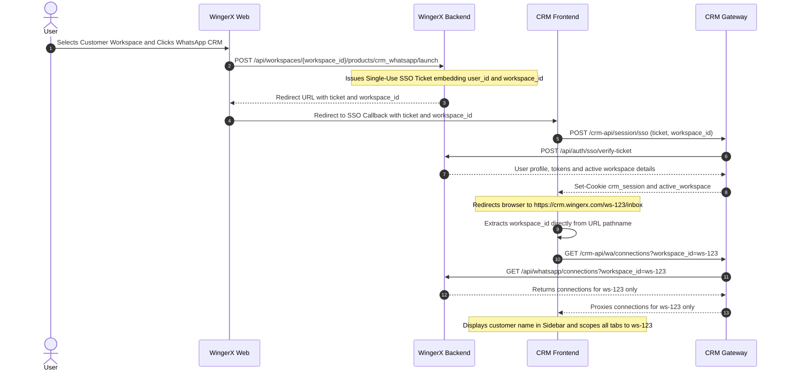

# WhatsApp CRM — Global Workspace Integration Architecture & Developer Guide

## Executive Summary & Architectural Rule

In WingerX, the core multi-tenancy model is strictly defined as:

$$\mathbf{1\ Customer\ =\ 1\ Workspace\ =\ 1\ WhatsApp\ CRM\ Instance}$$

* **1 Customer = 1 Workspace**: Every business or client has their own isolated workspace (e.g., `workspace_id: "ws-123"`).
* **1 Workspace = 1 WhatsApp CRM Environment**: When a user selects a workspace in WingerX `/home/[workspaceId]` and opens **WhatsApp CRM**, the CRM frontend (`wingerx-crm/wingerx-web`) and gateway (`wingerx-crm/session-gateway`) must strictly operate **within the context of that selected workspace**.
* **Zero Cross-Workspace Leakage**: All WhatsApp connections, active inbox conversations, message history, broadcast campaigns, contact directories, message templates, CRM connectors, and billing credits must belong **exclusively** to the active customer workspace.
* **The URL is the Single Source of Truth**: The active workspace **must be present in the URL** at all times (`https://crm.wingerx.com/{workspace_id}/*`), and all navigation inside the CRM must read the selected workspace directly from the URL.

---

## 1. High-Level Architecture & End-to-End Launch Flow



---

## 2. URL-Driven Workspace Routing (`https://crm.wingerx.com/{workspace_id}/*`)

> [!IMPORTANT]
> **Single Source of Truth Rule**:
> 1. When a user opens WhatsApp CRM from `https://app.wingerx.com/home/{workspace_id}`, the opened application URL must strictly be `https://crm.wingerx.com/{workspace_id}` (e.g. `https://crm.wingerx.com/{workspace_id}/inbox`). The workspace ID selected on `app.wingerx.com` must be carried forward and visible in the CRM URL.
> 2. Whenever the user navigates to any page or tab inside WhatsApp CRM (Inbox, Campaigns, Templates, Contacts, Billing, Connectors, Settings), the `{workspace_id}` **must remain in the URL path**: `https://crm.wingerx.com/{workspace_id}/{tab}`.
> 3. The CRM application **must extract the selected workspace directly from the URL itself** (`window.location.pathname`). The URL is the single source of truth, not backend memory or stale local storage.

### 2.1. URL Structure Standard

All pages and tabs within WhatsApp CRM must strictly follow the path-based workspace schema:

| Screen / Feature | Route Path | Description |
| :--- | :--- | :--- |
| **App Launch / Root Redirect** | `/` | Redirects authenticated user to `/{default_workspace_id}/inbox` |
| **SSO Callback** | `/auth/sso-callback?ticket=...&workspace_id=...` | Redeems ticket, then replaces browser URL with `/{workspace_id}/inbox` |
| **Connections Dashboard** | `/{workspace_id}` or `/{workspace_id}/instances` | View connected phone numbers for this workspace |
| **Connect WhatsApp** | `/{workspace_id}/onboarding` | Embedded signup / QR pairing for this workspace |
| **Live Inbox** | `/{workspace_id}/inbox` | Active conversations for this workspace |
| **Message Templates** | `/{workspace_id}/templates` | Approved Meta templates for this workspace |
| **Bulk Campaigns** | `/{workspace_id}/campaigns` | Broadcast campaigns for this workspace |
| **Contacts Directory** | `/{workspace_id}/contacts` | Audience directory for this workspace |
| **WhatsApp Billing** | `/{workspace_id}/billing` | Wallet balance & usage for this workspace |
| **CRM Connectors** | `/{workspace_id}/connectors` | Twenty/Zoho/Odoo integrations for this workspace |

### 2.2. Navigation & Deep-Linking Rules

1. **Tab Navigation (Preserve `{workspace_id}` in URL)**:
   When a user clicks any tab in the sidebar (for example, navigating from "Connections" to "Live Inbox", or from "Live Inbox" to "Bulk Campaigns"), the application must navigate to `/{workspace_id}/{tab}` (e.g., `/{workspace_id}/inbox`, `/{workspace_id}/campaigns`), preserving the active `{workspace_id}` at all times.
2. **Selected Workspace Derived Directly from URL**:
   When any page loads, mounts, or route changes:
   - The app extracts `workspace_id` directly from `window.location.pathname` (or React router params).
   - It validates that the authenticated user has access to this `workspace_id` (via `/crm-api/wa/workspaces`).
   - If valid, sets this workspace as active and synchronizes the session via `POST /crm-api/session/active-workspace`.
   - If invalid or unauthorized, shows a **403/404 Access Denied** screen with a link to return to `app.wingerx.com`.
3. **Direct URL Entry / Bookmarks**:
   If a user pastes or refreshes `https://crm.wingerx.com/ws-999/inbox`, the application parses `ws-999` from the URL, verifies access, and loads the data exclusively for `ws-999`.
4. **Workspace Switcher Navigation**:
   When the user switches workspaces using the header dropdown, the app navigates the browser directly to:
   $$\text{https://crm.wingerx.com/}\{\text{new\_workspace\_id}\}/\{\text{current\_tab}\}$$

---

## 3. Current Gaps in `wingerx-crm`

| Component | Current State | Target "One Workspace" State |
| :--- | :--- | :--- |
| **Launch Ticket** | Ticket contains only `user_id` and `target_service`. Does not bind `workspace_id`. | Ticket must store and verify `workspace_id`, returning the authorized workspace metadata. |
| **URL Routing** | Flat paths (`/`, `/inbox`, `/campaigns`) without workspace scoping. | URL path-based routing: `https://crm.wingerx.com/{workspace_id}/{tab}`. |
| **Session Gateway** | `POST /crm-api/session/sso` exchanges ticket and stores `user` only in session. | Session must store and track `active_workspace_id`. Expose it via `/crm-api/session/me`. |
| **CRM Web State** | `useAuth()` loads user profile; calls `/wa/workspaces` and treats all workspaces as generic "instances". | Dedicated `WorkspaceContext` parsing `workspaceId` directly from the URL. |
| **Sidebar Branding** | Hardcoded fallback: `user?.organizationName \|\| 'Neurixa Enterprise Workspace'`. | Dynamically displays current customer workspace name (`activeWorkspace.name`). |
| **Feature Pages** | `Inbox`, `Campaigns`, `Templates`, `Contacts`, etc., receive an array of all instances/workspaces. | All feature tabs are strictly scoped to `activeWorkspaceId` parsed from the URL. |

---

## 4. Required Changes in `wingerx-crm/session-gateway`

The Session Gateway acts as the secure Backend-For-Frontend (BFF) proxying to `workflow_automation`.

### 4.1. Update SSO Verification & Session Creation (`app/main.py`)

In `POST /crm-api/session/sso`:
1. Receive `workspace_id` from the payload:
   ```python
   ticket = body.get("ticket", "")
   requested_workspace_id = body.get("workspace_id")
   ```
2. When calling `_backend("POST", "/api/auth/sso/verify-ticket", ...)`:
   The backend returns:
   ```json
   {
     "success": true,
     "user": { "id": "...", "email": "...", "name": "...", "role": "..." },
     "workspace": { "id": "ws-123", "name": "Acme Corp" },
     "tokens": { "access_token": "..." }
   }
   ```
3. Update `_open_session`:
   ```python
   async def _open_session(token: str, user: dict, workspace: Optional[dict] = None) -> JSONResponse:
       active_ws = workspace
       if not active_ws:
           workspaces = await _operable_workspace_list(request, {"token": token})
           active_ws = workspaces[0] if workspaces else None

       session_id = _generate_session_id()
       session_data = {
           "token": token,
           "user": user,
           "active_workspace": active_ws,
           "created_at": time.time(),
       }
       await session_store.set(session_id, session_data)
   ```

### 4.2. Expose and Update Active Workspace via Session Endpoints

1. **`GET /crm-api/session/me`**:
   Return the active workspace alongside the user:
   ```json
   {
     "user": {
       "id": "usr-123",
       "email": "owner@acme.com",
       "name": "Jane Doe",
       "role": "owner"
     },
     "active_workspace": {
       "id": "ws-123",
       "name": "Acme Corp",
       "can_manage_whatsapp": true
     }
   }
   ```

2. **`POST /crm-api/session/active-workspace`** *(New Endpoint)*:
   Allow switching the active workspace for users who belong to multiple workspaces:
   ```python
   @app.post("/crm-api/session/active-workspace")
   async def switch_active_workspace(
       request: Request,
       session: dict = Depends(require_session),
   ):
       _check_csrf(request)
       body = await _json_body(request)
       new_workspace_id = body.get("workspace_id")
       if not new_workspace_id:
           return _fail("workspace_id is required", 400)
       
       # Authorize: Ensure user has membership/access to this workspace
       record = await _workspace_record(request, session, new_workspace_id)
       if not record:
           return _fail("Workspace access denied or workspace not found", 403)
       
       session["active_workspace"] = record
       await session_store.set(session["id"], session)
       return {"success": True, "active_workspace": record}
   ```

### 4.3. Auto-Inject `workspace_id` in Proxied Calls

In `session-gateway`, whenever `/crm-api/wa/*` routes are called without an explicit `workspace_id` query param, automatically fallback to `session["active_workspace"]["id"]`:
```python
params = dict(request.query_params)
if "workspace_id" not in params and session.get("active_workspace"):
    params["workspace_id"] = session["active_workspace"]["id"]
```

---

## 5. Required Changes in `wingerx-crm/wingerx-web`

### 5.1. SSO Callback & URL Redirect (`src/features/auth/api/use-auth.ts`)

Update `checkAuth` to parse `ticket` and `workspace_id` on launch, exchange the ticket, and immediately redirect to the workspace route:

```typescript
// Parse query parameters from SSO launch
const ssoTicket = urlParams.get('ticket');
const launchWorkspaceId = urlParams.get('workspace_id') || urlParams.get('workspaceId');

if (ssoTicket) {
  try {
    const ssoRes = await crmFetch('/session/sso', {
      method: 'POST',
      body: JSON.stringify({
        ticket: ssoTicket,
        workspace_id: launchWorkspaceId || undefined,
      }),
    });
    const ssoJson = await ssoRes.json();
    if (!ssoRes.ok) throw new Error(ssoJson.detail || 'Sign-in failed');

    const targetWsId = launchWorkspaceId || ssoJson.active_workspace?.id;
    // Redirect browser to the workspace-scoped URL
    window.location.replace(`/${targetWsId}/inbox`);
    return;
  } catch (err: any) {
    setError(err.message);
  }
}
```

### 5.2. URL-First Workspace Provider (`src/features/workspace/context/workspace-context.tsx`)

Create a React Context that extracts `workspace_id` directly from `window.location.pathname`:

```typescript
import React, { createContext, useContext, useState, useEffect } from 'react';
import { crmFetch } from '@/lib/fetch-api';

export interface Workspace {
  id: string;
  name: string;
  can_manage_whatsapp: boolean;
  is_default?: boolean;
}

interface WorkspaceContextType {
  activeWorkspace: Workspace | null;
  activeWorkspaceId: string;
  activeTab: string;
  workspaces: Workspace[];
  isLoading: boolean;
  isUnauthorized: boolean;
  navigateToTab: (tab: string) => void;
  switchWorkspace: (workspaceId: string) => void;
  refetchWorkspaces: () => Promise<void>;
}

const WorkspaceContext = createContext<WorkspaceContextType | null>(null);

// Extract /{workspace_id}/{tab} from pathname
export function parseRouteInfo() {
  const parts = window.location.pathname.split('/').filter(Boolean);
  // Ignore special auth paths
  if (parts[0] === 'auth' || parts[0] === 'login') {
    return { workspaceId: '', tab: '' };
  }
  const workspaceId = parts[0] || '';
  const tab = parts[1] || 'instances';
  return { workspaceId, tab };
}

export const WorkspaceProvider: React.FC<{ children: React.ReactNode }> = ({ children }) => {
  const [workspaces, setWorkspaces] = useState<Workspace[]>([]);
  const [activeWorkspace, setActiveWorkspace] = useState<Workspace | null>(null);
  const [isLoading, setIsLoading] = useState(true);
  const [isUnauthorized, setIsUnauthorized] = useState(false);

  const { workspaceId: routeWsId, tab: routeTab } = parseRouteInfo();

  const loadWorkspaces = async () => {
    try {
      setIsLoading(true);
      const res = await crmFetch('/wa/workspaces');
      if (!res.ok) throw new Error('Failed to load workspaces');
      const json = await res.json();
      const list: Workspace[] = json.workspaces || [];
      setWorkspaces(list);

      // 1. Resolve workspace from URL
      if (routeWsId) {
        const matched = list.find((w) => w.id === routeWsId);
        if (matched) {
          setActiveWorkspace(matched);
          setIsUnauthorized(false);
          // Sync backend session
          crmFetch('/session/active-workspace', {
            method: 'POST',
            body: JSON.stringify({ workspace_id: matched.id }),
          });
        } else {
          // User does not have access to this workspace
          setIsUnauthorized(true);
        }
      } else if (list.length > 0) {
        // Root path without workspace -> redirect to default
        const defaultWs = list.find((w) => w.is_default) || list[0];
        window.history.replaceState(null, '', `/${defaultWs.id}/instances`);
        setActiveWorkspace(defaultWs);
        setIsUnauthorized(false);
      }
    } catch {
      setIsUnauthorized(true);
    } finally {
      setIsLoading(false);
    }
  };

  const navigateToTab = (tab: string) => {
    if (!activeWorkspace) return;
    window.history.pushState(null, '', `/${activeWorkspace.id}/${tab}`);
    // Trigger popstate/re-render
    window.dispatchEvent(new PopStateEvent('popstate'));
  };

  const switchWorkspace = (newWorkspaceId: string) => {
    const currentTab = parseRouteInfo().tab || 'instances';
    window.location.assign(`/${newWorkspaceId}/${currentTab}`);
  };

  useEffect(() => {
    loadWorkspaces();

    const handlePopState = () => {
      const { workspaceId: currentWsId } = parseRouteInfo();
      if (currentWsId && workspaces.length > 0) {
        const matched = workspaces.find((w) => w.id === currentWsId);
        if (matched) setActiveWorkspace(matched);
      }
    };
    window.addEventListener('popstate', handlePopState);
    return () => window.removeEventListener('popstate', handlePopState);
  }, [routeWsId]);

  return (
    <WorkspaceContext.Provider
      value={{
        activeWorkspace,
        activeWorkspaceId: activeWorkspace?.id || '',
        activeTab: routeTab,
        workspaces,
        isLoading,
        isUnauthorized,
        navigateToTab,
        switchWorkspace,
        refetchWorkspaces: loadWorkspaces,
      }}
    >
      {children}
    </WorkspaceContext.Provider>
  );
};

export const useWorkspace = () => {
  const ctx = useContext(WorkspaceContext);
  if (!ctx) throw new Error('useWorkspace must be used within WorkspaceProvider');
  return ctx;
};
```

### 5.3. Update Main Layout & Header (`src/App.tsx`)

1. **Sidebar Navigation Updates**:
   When navigating between tabs, use `navigateToTab('inbox')` instead of `setActiveNav('inbox')`:
   ```tsx
   <button
     onClick={() => navigateToTab('inbox')}
     className={activeTab === 'inbox' ? 'bg-[#2563EB] text-white' : ''}
   >
     <MessageSquare className="w-4 h-4 shrink-0" />
     <span>Live Inbox</span>
   </button>
   ```

2. **Sidebar Customer Name**:
   Replace:
   ```tsx
   <span>
     {user?.organizationName ||
       (isSuperAdmin ? 'Platform Administration' : 'Neurixa Enterprise Workspace')}
   </span>
   ```
   With:
   ```tsx
   <div className="flex flex-col">
     <span className="font-semibold text-xs text-[var(--foreground)]">
       {activeWorkspace?.name || 'Customer Workspace'}
     </span>
     <span className="text-[10px] text-[var(--muted-foreground)]">
       {activeWorkspace?.can_manage_whatsapp ? 'Administrator' : 'Member'}
     </span>
   </div>
   ```

3. **Workspace Selector Dropdown (Header)**:
   Add a dropdown in the top header beside the Refresh button that calls `switchWorkspace(selectedId)` which immediately updates the URL.

4. **Topology / Instances Loading (`useWaTopology`)**:
   Modify `loadTopology` to scope connection queries strictly to `activeWorkspaceId`:
   ```typescript
   const loadTopology = useCallback(async (targetWsId?: string): Promise<WhatsAppInstance[]> => {
     const wsId = targetWsId || activeWorkspaceId;
     if (!wsId) return [];

     const res = await crmFetch(`/wa/connections?workspace_id=${encodeURIComponent(wsId)}`);
     const connections = await readJson(res);
     return mapConnectionsToInstances(wsId, connections);
   }, [activeWorkspaceId]);
   ```

---

## 6. Scoping WhatsApp CRM Feature Tabs

Each feature tab in `wingerx-web` must be scoped to `activeWorkspaceId`:

| Tab / Component | File | Required Scoping Update |
| :--- | :--- | :--- |
| **WhatsApp Connections** | `features/whatsapp-connection/components/connection-manager.tsx` | Display and test Meta Cloud API / QR connections belonging **only** to `activeWorkspaceId`. |
| **Connect WhatsApp (Onboarding)** | `features/whatsapp-onboarding/components/whatsapp-onboarding-page.tsx` | Run Meta Embedded Signup flow passing `workspace_id: activeWorkspaceId`. |
| **Live Inbox** | `features/inbox/components/live-inbox-page.tsx` | Fetch conversations with `GET /crm-api/wa/conversations?workspace_id=${activeWorkspaceId}`. Human takeover and message sends execute under `activeWorkspaceId`. |
| **Message Templates** | `features/templates/components/template-pilot-page.tsx` | List and sync Meta approved message templates for `activeWorkspaceId`'s WABA connection. |
| **Bulk Campaigns** | `features/campaigns/components/bulk-campaigns-dashboard.tsx` | Restrict broadcast campaign creation and dispatch to `activeWorkspaceId` recipients. |
| **Contacts Directory** | `features/contacts/components/contacts-page.tsx` | Filter contact search, tags, and CSV import to `activeWorkspaceId`. |
| **WhatsApp Billing** | `features/billing/components/whatsapp-billing-page.tsx` | Query wallet funds and conversation rate cards for `activeWorkspaceId`. |
| **CRM Connectors** | `features/crm-connectors/components/crm-connectors-page.tsx` | Configure Twenty/Zoho/Odoo data syncing scoped to `activeWorkspaceId`. |

---

## 7. Corresponding Backend Changes in `workflow_automation`

To ensure full compatibility with the CRM changes, `workflow_automation` must provide the workspace identity during launch:

1. **`POST /api/workspaces/{workspace_id}/products/crm_whatsapp/launch`** in `workspace_home.py`:
   ```python
   result = await generate_sso_ticket(
       GenerateTicketRequest(
           target_service="whatsapp_crm",
           redirect_base_url="https://crm.wingerx.com",
           workspace_id=ctx[0].id,  # <-- Bind customer workspace
       ),
       current_user=ctx[1],
       db=db,
   )
   ```

2. **Ticket Payload Storage in `sso_service.py`**:
   Store `workspace_id` in Redis ticket data:
   ```python
   ticket_data = {
       "ticket": ticket,
       "user_id": user_id,
       "workspace_id": workspace_id,
       "target_service": target_service,
       ...
   }
   ```

3. **Verify Ticket Endpoint (`POST /api/auth/sso/verify-ticket`)**:
   Return the workspace details alongside user profile:
   ```python
   ws = db.get(Workspace, ticket_data.get("workspace_id"))
   return {
       "success": True,
       "user": user_data,
       "workspace": {
           "id": ws.id,
           "name": ws.name or ws.title,
       } if ws else None,
       "tokens": tokens,
   }
   ```

---

## 8. Developer Implementation Checklist

### Phase 1: SSO & Session Gateway
- [ ] Update `POST /crm-api/session/sso` to parse and store `workspace_id`.
- [ ] Update `GET /crm-api/session/me` to return `active_workspace`.
- [ ] Implement `POST /crm-api/session/active-workspace` with workspace authorization validation.
- [ ] Add auto-injection of `workspace_id` in `session-gateway` proxy handlers.

### Phase 2: URL Routing & Frontend Context
- [ ] Implement `parseRouteInfo()` and `WorkspaceProvider` in `src/features/workspace/context/workspace-context.tsx`.
- [ ] Ensure `window.location.pathname` maps to `/{workspace_id}/{tab}`.
- [ ] Wrap `App.tsx` with `WorkspaceProvider`.
- [ ] Update sidebar navigation to call `navigateToTab` updating the URL path.
- [ ] Replace hardcoded `'Neurixa Enterprise Workspace'` in the sidebar with dynamic `activeWorkspace.name`.
- [ ] Add workspace switcher dropdown in top header navigating to `/{new_workspace_id}/{tab}`.

### Phase 3: Tab Scoping
- [ ] Update `useWaTopology` to fetch connections solely for `activeWorkspaceId`.
- [ ] Verify `LiveInboxPage` queries only `activeWorkspaceId` conversations.
- [ ] Verify `ContactsPage` imports contacts into `activeWorkspaceId`.
- [ ] Verify `BulkCampaignsDashboard` launches campaigns under `activeWorkspaceId`.
- [ ] Verify `WhatsAppOnboardingPage` binds newly connected numbers to `activeWorkspaceId`.

### Phase 4: Acceptance Testing
- [ ] **URL Persistence Test**: Navigate to `/ws-123/inbox`, click on "Campaigns". Verify URL becomes `/ws-123/campaigns`.
- [ ] **Cross-Tenant Test**: Open CRM under Customer A (`workspace_A`). Verify only Customer A's chats and numbers appear.
- [ ] **Direct URL / Refresh Test**: Refresh browser on `https://crm.wingerx.com/ws-123/inbox`. Verify active workspace is preserved directly from the URL.
- [ ] **Switching Test**: Switch to Customer B via header dropdown. Verify URL changes to `/workspace_B/inbox` and data updates.
- [ ] **Authorization Test**: Paste an unauthorized workspace ID into the URL (`/foreign-ws/inbox`). Confirm app presents Access Denied / 403.
