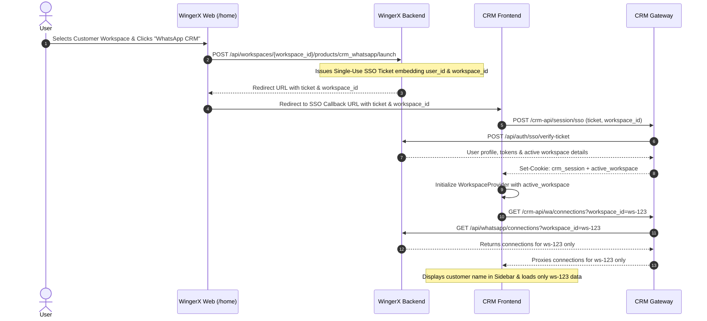

# WhatsApp CRM — Global Workspace Integration Architecture & Developer Guide

## Executive Summary & Architectural Rule

In WingerX, the core multi-tenancy model is strictly defined as:

$$\mathbf{1\ Customer\ =\ 1\ Workspace\ =\ 1\ WhatsApp\ CRM\ Instance}$$

* **1 Customer = 1 Workspace**: Every business or client has their own isolated workspace (e.g., `workspace_id: "ws-123"`).
* **1 Workspace = 1 WhatsApp CRM Environment**: When a user selects a workspace in WingerX `/home/[workspaceId]` and opens **WhatsApp CRM**, the CRM frontend (`wingerx-crm/wingerx-web`) and gateway (`wingerx-crm/session-gateway`) must strictly operate **within the context of that selected workspace**.
* **Zero Cross-Workspace Leakage**: All WhatsApp connections, active inbox conversations, message history, broadcast campaigns, contact directories, message templates, CRM connectors, and billing credits must belong **exclusively** to the active customer workspace.

---

## 1. High-Level Architecture & End-to-End Launch Flow



---

## 2. Current Gaps in `wingerx-crm`

| Component | Current State | Target "One Workspace" State |
| :--- | :--- | :--- |
| **Launch Ticket** | Ticket contains only `user_id` and `target_service`. Does not bind `workspace_id`. | Ticket must store and verify `workspace_id`, returning the authorized workspace metadata. |
| **Session Gateway** | `POST /crm-api/session/sso` exchanges ticket and stores `user` only in session. | Session must store and track `active_workspace_id`. Expose it via `/crm-api/session/me`. |
| **CRM Web State** | `useAuth()` loads user profile; calls `/wa/workspaces` and treats all workspaces as generic "instances". | Dedicated `WorkspaceContext` managing `activeWorkspaceId`, `activeWorkspaceName`, and available workspaces. |
| **Sidebar Branding** | Hardcoded fallback: `user?.organizationName \|\| 'Neurixa Enterprise Workspace'`. | Dynamically displays current customer workspace name (`activeWorkspace.name`). |
| **Feature Pages** | `Inbox`, `Campaigns`, `Templates`, `Contacts`, etc., receive an array of all instances/workspaces. | All feature tabs are strictly scoped to `activeWorkspaceId`. |

---

## 3. Required Changes in `wingerx-crm/session-gateway`

The Session Gateway acts as the secure Backend-For-Frontend (BFF) proxying to `workflow_automation`.

### 3.1. Update SSO Verification & Session Creation (`app/main.py`)

In `POST /crm-api/session/sso`:
1. Receive `workspace_id` optionally in the payload if provided from the URL query params:
   ```python
   ticket = body.get("ticket", "")
   requested_workspace_id = body.get("workspace_id")
   ```
2. When calling `_backend("POST", "/api/auth/sso/verify-ticket", ...)`:
   The backend returns:
   ```json
   {
     "success": true,
     "user": { "id": "...", "email": "...", "name": "...", "role": "..." },
     "workspace": { "id": "ws-123", "name": "Acme Corp" },
     "tokens": { "access_token": "..." }
   }
   ```
3. Update `_open_session`:
   ```python
   async def _open_session(token: str, user: dict, workspace: Optional[dict] = None) -> JSONResponse:
       # Determine active workspace: from ticket verification, or first operable workspace
       active_ws = workspace
       if not active_ws:
           # Fallback: query user's operable workspaces and select default
           workspaces = await _operable_workspace_list(request, {"token": token})
           active_ws = workspaces[0] if workspaces else None

       session_id = _generate_session_id()
       session_data = {
           "token": token,
           "user": user,
           "active_workspace": active_ws,
           "created_at": time.time(),
       }
       await session_store.set(session_id, session_data)
       # Return response with active_workspace
   ```

### 3.2. Expose and Update Active Workspace via Session Endpoints

1. **`GET /crm-api/session/me`**:
   Return the active workspace alongside the user:
   ```json
   {
     "user": {
       "id": "usr-123",
       "email": "owner@acme.com",
       "name": "Jane Doe",
       "role": "owner"
     },
     "active_workspace": {
       "id": "ws-123",
       "name": "Acme Corp",
       "can_manage_whatsapp": true
     }
   }
   ```

2. **`POST /crm-api/session/active-workspace`** *(New Endpoint)*:
   Allow switching the active workspace for users who belong to multiple workspaces:
   ```python
   @app.post("/crm-api/session/active-workspace")
   async def switch_active_workspace(
       request: Request,
       session: dict = Depends(require_session),
   ):
       _check_csrf(request)
       body = await _json_body(request)
       new_workspace_id = body.get("workspace_id")
       if not new_workspace_id:
           return _fail("workspace_id is required", 400)
       
       # Authorize: Ensure user has membership/access to this workspace
       record = await _workspace_record(request, session, new_workspace_id)
       if not record:
           return _fail("Workspace access denied or workspace not found", 403)
       
       session["active_workspace"] = record
       await session_store.set(session["id"], session)
       return {"success": True, "active_workspace": record}
   ```

### 3.3. Auto-Inject `workspace_id` in Proxied Calls

In `session-gateway`, whenever `/crm-api/wa/*` routes are called without an explicit `workspace_id` query param, automatically fallback to `session["active_workspace"]["id"]`:
```python
params = dict(request.query_params)
if "workspace_id" not in params and session.get("active_workspace"):
    params["workspace_id"] = session["active_workspace"]["id"]
```

---

## 4. Required Changes in `wingerx-crm/wingerx-web`

### 4.1. Capture Workspace in `useAuth` (`src/features/auth/api/use-auth.ts`)

Update `checkAuth` to parse both `ticket` and `workspace_id` (or `workspaceId`) from the query string:

```typescript
// Parse query parameters
const ssoTicket = urlParams.get('ticket');
const targetWorkspaceId = urlParams.get('workspace_id') || urlParams.get('workspaceId');

if (ssoTicket) {
  // Strip params from URL
  window.history.replaceState({}, document.title, window.location.pathname);

  const ssoRes = await crmFetch('/session/sso', {
    method: 'POST',
    body: JSON.stringify({
      ticket: ssoTicket,
      workspace_id: targetWorkspaceId || undefined,
    }),
  });
  const data = await ssoRes.json();
  // Store user and active_workspace in state
}
```

### 4.2. Create Global Workspace Provider (`src/features/workspace/context/workspace-context.tsx`)

Create a clean React context to manage active customer workspace across the CRM:

```typescript
import React, { createContext, useContext, useState, useEffect } from 'react';
import { crmFetch } from '@/lib/fetch-api';

export interface Workspace {
  id: string;
  name: string;
  can_manage_whatsapp: boolean;
  is_default?: boolean;
}

interface WorkspaceContextType {
  activeWorkspace: Workspace | null;
  activeWorkspaceId: string;
  workspaces: Workspace[];
  isLoading: boolean;
  switchWorkspace: (workspaceId: string) => Promise<void>;
  refetchWorkspaces: () => Promise<void>;
}

const WorkspaceContext = createContext<WorkspaceContextType | null>(null);

export const WorkspaceProvider: React.FC<{ children: React.ReactNode }> = ({ children }) => {
  const [workspaces, setWorkspaces] = useState<Workspace[]>([]);
  const [activeWorkspace, setActiveWorkspace] = useState<Workspace | null>(null);
  const [isLoading, setIsLoading] = useState(true);

  const loadWorkspaces = async () => {
    try {
      setIsLoading(true);
      const res = await crmFetch('/wa/workspaces');
      if (res.ok) {
        const json = await res.json();
        const list = json.workspaces || [];
        setWorkspaces(list);

        // Retrieve saved workspace ID or default to session/first workspace
        const savedWsId = localStorage.getItem('wingerx_crm_active_ws');
        const matched = list.find((w: Workspace) => w.id === savedWsId) || list[0] || null;
        setActiveWorkspace(matched);
      }
    } finally {
      setIsLoading(false);
    }
  };

  const switchWorkspace = async (workspaceId: string) => {
    const target = workspaces.find((w) => w.id === workspaceId);
    if (!target) return;

    await crmFetch('/session/active-workspace', {
      method: 'POST',
      body: JSON.stringify({ workspace_id: workspaceId }),
    });

    localStorage.setItem('wingerx_crm_active_ws', workspaceId);
    setActiveWorkspace(target);
  };

  useEffect(() => {
    loadWorkspaces();
  }, []);

  return (
    <WorkspaceContext.Provider
      value={{
        activeWorkspace,
        activeWorkspaceId: activeWorkspace?.id || '',
        workspaces,
        isLoading,
        switchWorkspace,
        refetchWorkspaces: loadWorkspaces,
      }}
    >
      {children}
    </WorkspaceContext.Provider>
  );
};

export const useWorkspace = () => {
  const ctx = useContext(WorkspaceContext);
  if (!ctx) throw new Error('useWorkspace must be used within WorkspaceProvider');
  return ctx;
};
```

### 4.3. Update Main Layout & Header (`src/App.tsx`)

1. **Sidebar Customer Name**:
   Replace:
   ```tsx
   <span>
     {user?.organizationName ||
       (isSuperAdmin ? 'Platform Administration' : 'Neurixa Enterprise Workspace')}
   </span>
   ```
   With:
   ```tsx
   <div className="flex flex-col">
     <span className="font-semibold text-xs text-[var(--foreground)]">
       {activeWorkspace?.name || 'Customer Workspace'}
     </span>
     <span className="text-[10px] text-[var(--muted-foreground)]">
       {activeWorkspace?.can_manage_whatsapp ? 'Administrator' : 'Member'}
     </span>
   </div>
   ```

2. **Workspace Selector Dropdown (Header)**:
   Add a dropdown in the top header beside the Refresh button allowing users with access to multiple workspaces to switch between customers without returning to `/home`.

3. **Topology / Instances Loading (`useWaTopology`)**:
   Modify `loadTopology` to scope connection queries strictly to `activeWorkspaceId`:
   ```typescript
   // In useWaTopology:
   const loadTopology = useCallback(async (targetWsId?: string): Promise<WhatsAppInstance[]> => {
     const wsId = targetWsId || activeWorkspaceId;
     if (!wsId) return [];

     const res = await crmFetch(`/wa/connections?workspace_id=${encodeURIComponent(wsId)}`);
     const connections = await readJson(res);
     // Map only connections for the active workspace
     return mapConnectionsToInstances(wsId, connections);
   }, [activeWorkspaceId]);
   ```

---

## 5. Scoping WhatsApp CRM Feature Tabs

Each feature tab in `wingerx-web` must be scoped to `activeWorkspaceId`:

| Tab / Component | File | Required Scoping Update |
| :--- | :--- | :--- |
| **WhatsApp Connections** | `features/whatsapp-connection/components/connection-manager.tsx` | Display and test Meta Cloud API / QR connections belonging **only** to `activeWorkspaceId`. |
| **Connect WhatsApp (Onboarding)** | `features/whatsapp-onboarding/components/whatsapp-onboarding-page.tsx` | Run Meta Embedded Signup flow passing `workspace_id: activeWorkspaceId`. |
| **Live Inbox** | `features/inbox/components/live-inbox-page.tsx` | Fetch conversations with `GET /crm-api/wa/conversations?workspace_id=${activeWorkspaceId}`. Human takeover and message sends execute under `activeWorkspaceId`. |
| **Message Templates** | `features/templates/components/template-pilot-page.tsx` | List and sync Meta approved message templates for `activeWorkspaceId`'s WABA connection. |
| **Bulk Campaigns** | `features/campaigns/components/bulk-campaigns-dashboard.tsx` | Restrict broadcast campaign creation and dispatch to `activeWorkspaceId` recipients. |
| **Contacts Directory** | `features/contacts/components/contacts-page.tsx` | Filter contact search, tags, and CSV import to `activeWorkspaceId`. |
| **WhatsApp Billing** | `features/billing/components/whatsapp-billing-page.tsx` | Query wallet funds and conversation rate cards for `activeWorkspaceId`. |
| **CRM Connectors** | `features/crm-connectors/components/crm-connectors-page.tsx` | Configure Twenty/Zoho/Odoo data syncing scoped to `activeWorkspaceId`. |

---

## 6. Corresponding Backend Changes in `workflow_automation`

To ensure full compatibility with the CRM changes, `workflow_automation` must provide the workspace identity during launch:

1. **`POST /api/workspaces/{workspace_id}/products/crm_whatsapp/launch`** in `workspace_home.py`:
   ```python
   # Pass workspace_id to generate_sso_ticket
   result = await generate_sso_ticket(
       GenerateTicketRequest(
           target_service="whatsapp_crm",
           redirect_base_url="https://crm.wingerx.com",
           workspace_id=ctx[0].id,  # <-- Bind customer workspace
       ),
       current_user=ctx[1],
       db=db,
   )
   ```

2. **Ticket Payload Storage in `sso_service.py`**:
   Store `workspace_id` in Redis ticket data:
   ```python
   ticket_data = {
       "ticket": ticket,
       "user_id": user_id,
       "workspace_id": workspace_id,
       "target_service": target_service,
       ...
   }
   ```

3. **Verify Ticket Endpoint (`POST /api/auth/sso/verify-ticket`)**:
   Return the workspace details alongside user profile:
   ```python
   ws = db.get(Workspace, ticket_data.get("workspace_id"))
   return {
       "success": True,
       "user": user_data,
       "workspace": {
           "id": ws.id,
           "name": ws.name or ws.title,
       } if ws else None,
       "tokens": tokens,
   }
   ```

---

## 7. Developer Implementation Checklist

### Phase 1: SSO & Session Gateway
- [ ] Update `POST /crm-api/session/sso` to parse and store `workspace_id`.
- [ ] Update `GET /crm-api/session/me` to return `active_workspace`.
- [ ] Implement `POST /crm-api/session/active-workspace` with workspace authorization validation.
- [ ] Add auto-injection of `workspace_id` in `session-gateway` proxy handlers.

### Phase 2: Frontend Context & Shell UI
- [ ] Implement `WorkspaceProvider` in `src/features/workspace/context/workspace-context.tsx`.
- [ ] Wrap `App.tsx` with `WorkspaceProvider`.
- [ ] Replace hardcoded `'Neurixa Enterprise Workspace'` in the sidebar with dynamic `activeWorkspace.name`.
- [ ] Add workspace switcher dropdown in top header.

### Phase 3: Tab Scoping
- [ ] Update `useWaTopology` to fetch connections solely for `activeWorkspaceId`.
- [ ] Verify `LiveInboxPage` queries only `activeWorkspaceId` conversations.
- [ ] Verify `ContactsPage` imports contacts into `activeWorkspaceId`.
- [ ] Verify `BulkCampaignsDashboard` launches campaigns under `activeWorkspaceId`.
- [ ] Verify `WhatsAppOnboardingPage` binds newly connected numbers to `activeWorkspaceId`.

### Phase 4: Acceptance Testing
- [ ] **Cross-Tenant Test**: Open CRM under Customer A (`workspace_A`). Verify only Customer A's chats and numbers appear.
- [ ] **Switching Test**: Switch to Customer B (`workspace_B`) via header dropdown or `/home/[workspace_B]`. Verify Customer A's data is immediately cleared and Customer B's data loads.
- [ ] **Direct URL / Refresh Test**: Refresh the browser on CRM. Verify active workspace is preserved and does not reset to a default or hardcoded organization.
- [ ] **Authorization Test**: Attempt to query Customer B's conversations using Customer A's session. Confirm server returns `403 Forbidden` / `404 Not Found`.
