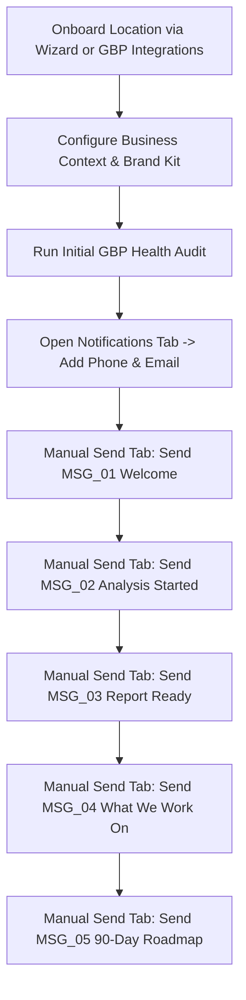
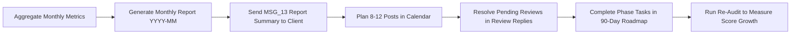

# Google Business Profile Marketing Module — Master Documentation & Operations Guide

Welcome to the comprehensive operational and feature guide for the **WingerX Google Business Profile (GBP) Marketing Automation** module.

This documentation suite covers end-to-end client onboarding, day-to-day content generation, safety governance, the 90-Day Growth Roadmap, WhatsApp/Email client notifications, and monthly client reporting SOPs.

> **Platform URL:** Go to https://app.wingerx.com/marketing page.

---

## 📚 Master Document Index

### Part 1: Core Operational Guides & SOPs
| File | Title | How to Access | Key Contents |
|---|---|---|---|
| [00-client-onboarding-and-notifications-guide.md](./00-client-onboarding-and-notifications-guide.md) | **Client Onboarding & Notification Delivery Guide** | Go to 'https://app.wingerx.com/marketing?setup=1' (Wizard), or go to https://app.wingerx.com/marketing page and click **Notifications** tab | Step-by-step onboarding, setting up client phone/email in Notifications, and delivering `MSG_01` to `MSG_05` via Manual Send. |
| [01-monthly-client-growth-and-reporting-sop.md](./01-monthly-client-growth-and-reporting-sop.md) | **Monthly Client Growth & Recurring Reporting SOP** | Go to https://app.wingerx.com/marketing page and click **Monthly Report** tab | Complete 4-week monthly playbook: metric aggregation, Monthly Growth Report generation (`YYYY-MM`), client delivery, and re-auditing. |

---

### Part 2: Feature Guides by Left Sidebar Tab
| # | Feature / Tab | How to Access | Documentation File | Core Functionality |
|---|---|---|---|---|
| **02** | **Dashboard** | Go to https://app.wingerx.com/marketing page and click **Dashboard** tab | [02-dashboard.md](./02-dashboard.md) | Central cockpit, health score, onboarding checklist, and real-time metric cards. |
| **03** | **Monthly Report** | Go to https://app.wingerx.com/marketing page and click **Monthly Report** tab | [03-monthly-report.md](./03-monthly-report.md) | Executive monthly digest (`YYYY-MM`), customer actions, reviews answered, and export. |
| **04** | **Calendar** | Go to https://app.wingerx.com/marketing page and click **Calendar** tab | [04-content-calendar.md](./04-content-calendar.md) | Month/Week interactive calendar, scheduling cadence, and post status tracking. |
| **05** | **Smart Posts** | Go to https://app.wingerx.com/marketing page and click **Smart Posts** tab | [05-smart-posts.md](./05-smart-posts.md) | AI-powered Google updates, promotional offers, events, and keyword integration. |
| **06** | **Review Replies** | Go to https://app.wingerx.com/marketing page and click **Review Replies** tab | [06-review-replies.md](./06-review-replies.md) | Sentiment-aware AI reply generation, 100% response rate targets, and reputation boost. |
| **07** | **Media Library** | Go to https://app.wingerx.com/marketing page and click **Media Library** tab | [07-media-library.md](./07-media-library.md) | Ingesting and tagging interior, exterior, team, and product photos to drive discovery. |
| **08** | **Blog Articles** | Go to https://app.wingerx.com/marketing page and click **Blog Articles** tab | [08-blog-articles.md](./08-blog-articles.md) | Long-form local SEO blog generation (800–1,500 words) to build organic search authority. |
| **09** | **Instagram & Social** | Go to https://app.wingerx.com/marketing page and click **Instagram** tab (or **Social Media** tab) | [09-instagram-and-social.md](./09-instagram-and-social.md) | Visual discovery, Instagram post preview, and cross-channel social marketing. |
| **10** | **Approval Queue** | Go to https://app.wingerx.com/marketing page and click **Approval Queue** tab | [10-approval-queue.md](./10-approval-queue.md) | Human-in-the-loop governance gate, risk tiers (Low/Med/High), and manual completion. |
| **11** | **Audit Log** | Go to https://app.wingerx.com/marketing page and click **Audit Log** tab | [11-audit-log.md](./11-audit-log.md) | Immutable event log tracking every AI generation, human approval, and dispatch. |
| **12** | **Tasks (90-Day Roadmap)** | Go to https://app.wingerx.com/marketing page and click **Tasks** tab | [12-90day-growth-roadmap.md](./12-90day-growth-roadmap.md) | 3-phase growth lifecycle (Foundation → Engagement → Authority), dynamic due dates & regenerate. |
| **13** | **Brand Identity** | Go to https://app.wingerx.com/marketing page and click **Brand Identity** tab | [13-brand-identity.md](./13-brand-identity.md) | Brand Kit, primary/accent colors, logo, brand voice presets, and prohibited claims. |
| **14** | **Prompts & Rules** | Go to https://app.wingerx.com/marketing page and click **Prompts & Rules** tab | [14-prompts-and-rules.md](./14-prompts-and-rules.md) | Customizing system prompts, length rules, emoji limits, and CTA button policies. |
| **15** | **Automation** | Go to https://app.wingerx.com/marketing page and click **Automation** tab | [15-automation-and-pipelines.md](./15-automation-and-pipelines.md) | Multi-step pipeline chains, execution logs, and automated cron schedules. |
| **16** | **GBP Integrations** | Go to https://app.wingerx.com/marketing page and click **GBP Integrations** tab | [16-gbp-integrations-and-audits.md](./16-gbp-integrations-and-audits.md) | Location settings, Google OAuth / Places sync, and automated GBP health audits. |
| **17** | **AI Usage Logs** | Go to https://app.wingerx.com/marketing page and click **AI Usage Logs** tab | [17-ai-usage-logs.md](./17-ai-usage-logs.md) | Token consumption tracking, model costs, and credit quota management. |
| **18** | **Notifications** | Go to https://app.wingerx.com/marketing page and click **Notifications** tab | [18-notifications-whatsapp-email.md](./18-notifications-whatsapp-email.md) | Full WhatsApp and Email channels, preferences, message history, and Manual Send catalog. |

---

## 🚀 High-Level Operational Workflows

### 1. New Client Onboarding Sequence

### 2. Monthly Recurring Client Maintenance

---

## 🛠️ Key Rules for Manual / Google Places Locations
If managing a client location without direct Google Account OAuth access:
* **Never click "Publish Directly"** on the profile; use **"Complete Manually"** in the **Approval Queue** tab.
* Enter physical business details and hours manually via **Location Settings** (under the **GBP Integrations** tab).
* All AI generation features (Smart Posts, Blogs, Review Replies, Keywords, Audits, Roadmap) function identically.
* Posts and review replies are drafted in WingerX, approved, and copied to Google Search/Maps by the account manager.
